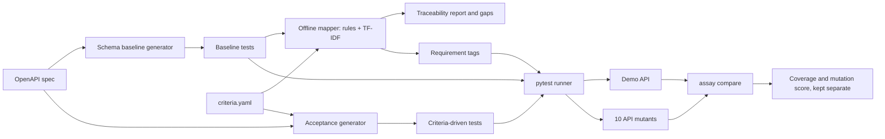

# assay

**Offline-first API test generation and requirement traceability.**

assay answers one question about an API: *do the tests we have actually check the requirements we wrote down?* Given an OpenAPI specification and structured acceptance criteria it generates runnable pytest tests, links each criterion to the tests that could verify it, reports the criteria with no real test, and then measures itself: how well the linking matches hand labels, how many requirements have a passing test, and how many deliberately broken versions of the API the tests catch. Those three measurements are reported separately and never merged into one number.

It is deterministic and fully offline. No API key is needed. An optional LLM mapper exists only as a disabled interface stub.

It is a learning-focused portfolio project for AI/ML engineering and QA automation. Everything below is measured on one small demo API and says nothing about other APIs.

## Results

`assay compare` runs three suites on the real demo API and on 10 hand-written mutants (copies of the API with one rule deliberately broken):

| Suite | Tests | Criteria with a passing tagged test | Mutants killed |
|---|---|---|---|
| A. Baseline (generated from the OpenAPI spec only) | 43 | 13 of 18 | 6 of 10 |
| B. Criteria-driven (one test per criterion) | 18 | 18 of 18 | 7 of 10 |
| C. Combined (A and B) | 61 | 18 of 18 | 9 of 10 |

Read these numbers with their limits:

- **Coverage is not comparable across suites.** A's tags come from the mapper, so it inherits the mapper's errors. B and C are generated from the criteria being counted, so their coverage is partly circular. It is a traceability measure, not proof of test quality.
- **Mutation score is the more independent check, and it is small.** 10 mutants, hand-written inside this project, not by an independent party, for this one API; some target behaviour the criteria describe. One mutant moves the score by 0.1. No mutant was declared equivalent.
- **What each suite misses.** A never asserts a response body and has no unknown-ID tests, so it misses `get_unknown_product_200`, `order_unknown_product_201` and `health_body_wrong`. B misses boundary mutants A catches. Nothing catches `category_accepts_toy`, so no test sends the valid value `toy`.
- **Mapper quality** was scored against 40 hand-labelled pairs (5 positives, one labeller). At the default threshold 0.4 it found 1 of 1 positives in the development half and 4 of 4 in the test half, with no false positives. That is a count, not a quality claim: the rules were revised after the labelled errors were seen, so the test half is not an independent holdout. The threshold 0.4 is a frozen default, not a tuned value, because the development half has too few positives for a sweep to choose one. Two AI second raters each agreed with the labels on 19 of 20 re-labelled pairs (kappa 0.773 each; Claude was not blind to the mapper, ChatGPT 6 was given a blind packet, as reported by the user); your own self-agreement pass, which measures one person's consistency, is still pending.

Full definitions are in `docs/METRICS.md`, the labelling protocol in `docs/LABELLING.md`.

## How it works

1. **Baseline.** Tests are derived from the OpenAPI document alone and never read the criteria: valid values, boundaries, wrong types, missing required fields, invalid enum values. Case IDs are stable hashes, so labels stay valid.
2. **Mapper.** Hard rules decide which tests could verify a criterion (same operation, same expected status, checks what the criterion needs, right field, right direction of the constraint); TF-IDF similarity then ranks the eligible ones against a threshold. A criterion with no match is reported with the reason. `response.status equals N` is matched by rule when a test asserts that status.
3. **Acceptance generator.** One explicit test per structured criterion, built from its fields only, never from guessed behaviour.
4. **Evaluation.** Mapping precision and recall against hand labels, requirement coverage, and mutation score, each its own measurement.

## Reproduce from a clean checkout

Requires Python 3.11 or newer. No network access is needed after installing.

    python -m venv .venv
    # Windows: .venv\Scripts\activate
    # macOS/Linux: source .venv/bin/activate
    python -m pip install --upgrade pip
    python -m pip install -e ".[dev]"
    pytest
    ruff check .
    assay compare            # the table above; writes reports/comparison/

Other commands:

    python scripts/export_openapi.py   # regenerate specs/openapi.json
    assay run                # export, run and report the generated baseline tests
    assay acceptance         # generate and run the criteria-driven tests
    assay map                # map criteria.yaml to baseline tests and report gaps
    assay evaluate mutants   # run the baseline against the 10 mutants
    assay evaluate mapping   # score the mapper on the filled label sheet
    assay evaluate relabel   # blank subset of the pairs to label again later
    assay evaluate agreement # compare the two labelling passes

Output is deterministic: running a command twice gives identical files. CI (Ubuntu 24.04, Python 3.11) runs the tests, regenerates the OpenAPI document and checks it did not change, runs `assay acceptance` and `assay compare`, and lints the code and the generated files.

## Status

| Milestone | State |
|---|---|
| M0 Skeleton, M1 Demo API, M2 Offline schema baseline | done |
| M3 Exporter and runner, M4 Requirement mapping | done |
| M5 Evaluation harness | done; a second-rater pass is recorded, the labeller's own self-agreement pass is pending |
| M6 Comparison and docs | done |

## Known limitations

- One labeller, 40 labelled pairs, 5 positives; the sample is stratified, not random.
- The mapper's rules were revised after labelled errors were seen; there is no independent holdout. Any claim that the mapper generalises needs a newly drawn, independently labelled sheet scored against a frozen mapper.
- 10 hand-written mutants on one demo API; results do not transfer to other APIs.
- Direct dependencies are pinned, transitive ones are not locked.
- Only a supported OpenAPI subset is handled; unsupported constructs fail with `UnsupportedSchemaError`.

## Documentation

`PLAN.md` (roadmap and decisions), `docs/SCHEMA_BASELINE.md`, `docs/RUNNER.md`, `docs/MAPPING.md`, `docs/METRICS.md`, `docs/LABELLING.md`.
