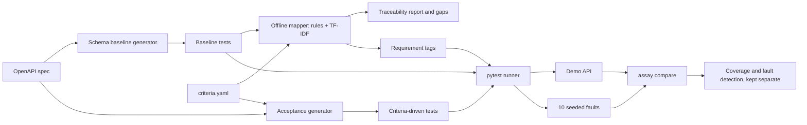

# assay

[](https://github.com/vaishnavi-kalmegh/assay/actions/workflows/ci.yml)

[](https://github.com/vaishnavi-kalmegh/assay/actions/workflows/ci.yml)

**Offline-first API test generation and requirement traceability.**

assay answers one question about an API: *do the tests we have actually check the requirements we wrote down?*

Given an OpenAPI specification and structured acceptance criteria, it generates runnable pytest tests and links each criterion to the tests that could verify it. It reports the criteria with no real test, then measures itself with three separate numbers: mapping precision and recall against hand labels, requirement coverage, and the share of seeded faults the tests detect. These are never merged into one score.

It is deterministic and fully offline, and needs no API key. An optional LLM mapper exists only as a disabled interface stub.

It is a learning-focused portfolio project between QA automation and ML evaluation. The matching uses classical text similarity (TF-IDF), not a language model; the ML-style practice is in how it is measured: hand labels, a development/test split, precision and recall, and seeded-fault detection. Everything below is measured on one small demo API and says nothing about other APIs.

## The problem

Teams usually know how many tests they have, not which requirement each one proves. A test can pass while the rule it was meant to guard is broken, and a requirement can have no test at all without anyone noticing. assay makes both checkable: it links requirements to tests, lists the requirements with no real test and why, and then checks whether the tests notice when the API is deliberately broken.

## Demo


The animation is rendered from the real captured output of these commands; only the typing is synthetic (`python scripts/make_demo_gif.py` regenerates it, needs Pillow). The last line shows the headline figures and, in brackets, the tuned result; see Results.

## Example

A requirement, written as structured data (`criteria.yaml`):

```yaml
- id: REQ-004
  method: POST
  path: /products
  field: request.name
  constraint: min_length
  value: 3
  expected_status: 422
  description: Product name shorter than three characters is rejected.
```

`assay map` links it to the baseline test generated from the OpenAPI spec, with its score:

```
| REQ-004 | BASE-BD70624B4DB6 (0.5813) POST /products — body.name — just below minimum length 3 |
```

`assay acceptance` generates a test for it directly from the same fields:

```python
@pytest.mark.req('REQ-004')
def test_req_004(client):
    response = client.post(
        '/products',
        json={'category': 'book', 'name': 'xx', 'price': 9.99},
    )
    assert response.status_code == 422, response.text
```

And when no test can verify a requirement, the report says why instead of staying silent:

```
| REQ-002 | needs_response_body_check | the criterion is about response.body.status, but the 1 candidate test(s) check only status |
```

The baseline asserts status codes only, so it cannot verify a rule about a response body; that is what the seeded-fault results below show.

## Results

`assay compare` runs three suites on the real demo API and on 10 seeded faults (hand-written copies of the API with one rule deliberately broken; these are not produced by automatic mutation operators):

| Suite | Tests | Criteria with a passing tagged test | Seeded faults detected |
|---|---|---|---|
| A. Baseline (generated from the OpenAPI spec only) | 43 | 13 of 18 | 6 of 10 |
| B. Criteria-driven (one test per criterion) | 18 | 18 of 18 † | 7 of 10 ‡ |
| C. Combined (A and B) | 61 | 18 of 18 † | 9 of 10 ‡ |

† True by construction: B's tests are generated from the criteria being counted, so every criterion has a test. This says nothing about test quality.

‡ Headline figures exclude one tuned kill. `category_accepts_toy` survived until REQ-009's test was extended with the value `toy`, after the fault was known. Counting it, B is 8 of 10 and C is 10 of 10.

Reading the numbers:

- **The detection score is small and not independent.** 10 faults, written in this project by the same author as the criteria and tests, and some target behaviour the criteria describe. It is less circular than coverage, not independent of it. One fault moves the score by 0.1, and no fault was declared equivalent.
- **What each suite misses.** A never asserts a response body and has no unknown-ID tests, so it misses `get_unknown_product_200`, `order_unknown_product_201` and `health_body_wrong`. B misses boundary faults A catches. No suite detects `category_accepts_toy` without the tuned test.
- **Mapper quality** was scored against 40 hand-labelled pairs (5 positives, one labeller). At the default threshold 0.4 it found 1 of 1 positives in the development half and 4 of 4 in the test half, with no false positives. That is a count, not a quality claim; see the limitations below.
- **What TF-IDF adds.** On the same 40 labelled pairs, the hard rules alone find all 5 positives but also predict 9 false ones (precision 0.36); adding TF-IDF at the frozen threshold removes all 9 (precision 1.00, recall 1.00); TF-IDF alone, without the rules, scores precision 0.57 and recall 0.80. So on this sample each part earns its place, but 5 positives from one labeller is a description, not evidence of general quality. See `docs/results/ablation.md`, regenerated by `assay evaluate ablation`.
- **Second raters.** Two AI models each agreed with the first labels on 19 of 20 re-labelled pairs: Claude (not blind to the mapper) and ChatGPT (given a blind packet; model name as stated by the labeller, unverified). Kappa is not reported because it is not meaningful at this size. The labeller's own self-agreement pass is not yet done.

The full generated report is committed at `docs/results/comparison.md` (a test fails if it goes stale). Definitions are in `docs/METRICS.md`, the labelling protocol in `docs/LABELLING.md`, and the reasoning behind each design choice and its limits in `docs/DESIGN_DECISIONS.md`.

## How it works



1. **Baseline.** Tests are derived from the OpenAPI document alone and never read the criteria: valid values, boundaries, wrong types, missing required fields, invalid enum values. Case IDs are stable hashes, so labels stay valid.
2. **Mapper.** Hard rules decide which tests could verify a criterion (same operation, same expected status, checks what the criterion needs, right field, right direction of the constraint); TF-IDF similarity then ranks the eligible ones against a threshold. A criterion with no match is reported with the reason. `response.status equals N` is matched by rule when a test asserts that status.
3. **Acceptance generator.** One explicit test per structured criterion, built from its fields only, never from guessed behaviour.
4. **Evaluation.** Mapping precision and recall against hand labels, requirement coverage, and seeded-fault detection (the mutation score), each its own measurement.

## Reproduce from a clean checkout

Requires Python 3.11 or newer; CI runs 3.11, 3.12 and 3.13 on Ubuntu and Windows. No network access is needed after installing.

    python -m venv .venv
    # Windows: .venv\Scripts\activate
    # macOS/Linux: source .venv/bin/activate
    python -m pip install --upgrade pip
    python -m pip install -e ".[dev]"
    pytest
    ruff check .
    assay compare            # the table above; writes reports/comparison/

Other commands:

    python scripts/export_openapi.py   # regenerate specs/openapi.json
    assay run                # export, run and report the generated baseline tests
    assay acceptance         # generate and run the criteria-driven tests
    assay map                # map criteria.yaml to baseline tests and report gaps
    assay evaluate mutants   # run the baseline against the 10 seeded faults
    assay evaluate mapping   # score the mapper on the filled label sheet
    assay evaluate ablation  # rules only vs rules + TF-IDF vs TF-IDF only
    assay evaluate relabel   # blank subset of the pairs to label again later
    assay evaluate agreement # compare the two labelling passes

Output is deterministic: running a command twice gives identical files, and tests check this across different hash seeds, that written files use Unix line endings, and that the committed results are byte-for-byte current. CI runs the tests, regenerates the OpenAPI document and checks it did not change, runs `assay acceptance` and `assay compare`, and lints the code and the generated files. Direct dependencies are pinned; transitive ones are not locked, so each CI run installs the latest compatible versions.

## Status

| Milestone | State |
|---|---|
| M0 Skeleton, M1 Demo API, M2 Offline schema baseline | done |
| M3 Exporter and runner, M4 Requirement mapping | done |
| M5 Evaluation harness | done; a second-rater pass is recorded, the labeller's own self-agreement pass is pending |
| M6 Comparison and docs | done |

## Related tools

assay is a learning project on one demo API, not a replacement for any of these; it asks a different question.

- Tools such as [Schemathesis](https://pypi.org/project/schemathesis/) generate test cases from an OpenAPI schema (property-based) to find crashes and schema violations. assay's baseline is simpler and deterministic, and its focus is whether *requirements* are verified, not finding new bugs.
- Mutation testing tools such as [mutmut](https://pypi.org/project/mutmut/) mutate a program's source code. assay mutates the API's behaviour (10 hand-written variants of the demo server) to see whether the tests notice.
- Test management tools keep a traceability matrix linking requirements to tests, usually maintained by hand. assay proposes the links automatically and measures how accurate its links are.

## Known limitations

- One labeller, 40 labelled pairs, 5 positives; the sample is stratified, not random.
- The mapper's rules were revised after labelled errors were seen, so the test half is not an independent holdout, and the threshold 0.4 is a frozen default because the development half has too few positives to tune one. A generalisation claim needs a newly drawn, independently labelled sheet scored against a frozen mapper.
- AI second raters are not independent human raters.
- The seeded faults and results are for one demo API and do not transfer to other APIs.
- Direct dependencies are pinned, transitive ones are not locked; CI installs fresh each run.
- Only a supported OpenAPI subset is handled; unsupported constructs fail with `UnsupportedSchemaError`.

## License

MIT. Copyright Vaishnavi Kalmegh. See `LICENSE`.

## Documentation

`PLAN.md` (roadmap and decisions), `docs/DESIGN_DECISIONS.md`, `docs/SCHEMA_BASELINE.md`, `docs/RUNNER.md`, `docs/MAPPING.md`, `docs/METRICS.md`, `docs/LABELLING.md`.
